# NuWriter Desktop GUI

[English](README.md) | [简体中文](README.zh-CN.md) | [繁體中文](README.zh-TW.md)

[Main guide](../README.md) | [Sample guide](../sample/README.md) | [Driver guide](../driver/README.md)

## Install And Start

Open the [download page](https://github.com/wosayttn/NUC980_PyNuWriter/releases/latest) and download the GUI package for your OS from **Assets**. GitHub sign-in is not required.
Extract the package and keep the complete directory. On Windows/Linux, keep `backend` beside the GUI executable.
Open `nuwriter-gui.exe` on Windows, `nuwriter-gui` on Linux, or `nuwriter-gui.app` on macOS.
On macOS, the CLI backend is included inside `nuwriter-gui.app`.

For source use, install the [drivers and OS dependencies](../README.md#install-from-source), then run these commands from `NUC980_PyNuWriter`:

```bash
python -m pip install -r gui/requirements.txt
```

```bash
python gui/app.py
```

A desktop session is required. Standalone packages do not require Python.

Windows screenshots below use example paths, addresses and results.

<p align="center">
	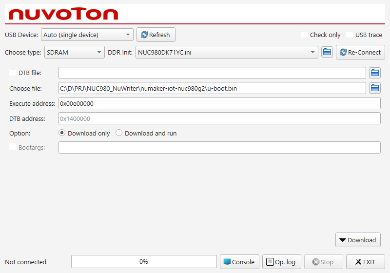
</p>

## Connect

1. Put the board in USB Boot mode and connect its USB Device port to the PC.
2. Select the target **Chip** (**NUC980** or **NUC970**), then select its **DDR Init** setting (`sys_cfg/nuc980/` for NUC980, `sys_cfg/nuc970/` for NUC970). Use **Refresh** to list devices.
3. Select a **USB Device**, or use **Auto** for one connected board.
4. Click **Re-Connect**. Repeat after resetting or power-cycling the board.

**Re-Connect may reset the board through a CH341 adapter.** Without that adapter, reset manually into USB Boot mode.
When **NUC970** is selected, **Choose type** replaces **SPI NAND** with **MTP**, and Flash/Pack editors expose an optional **AES Key** field (`key_cfg/nuc970/*.dat`). **Locking MTP permanently prevents future key changes.**

<p align="center">
	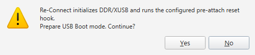
</p>

## Program, Read And Erase

1. Select **SPI NAND**, **SPI NOR**, **NAND**, or **SD/eMMC** under **Choose type**.
2. Click **Browse**, select an image row, then choose **Data**, **Environment**, **Loader**, or **Pack**.
3. Enter the start offset and, for a loader, its execution address.
4. Click **Program**. Enable **Program + Verify** to check the written image.

**Program writes the selected row only.** Offsets and lengths are bytes; enter hexadecimal values such as `0x100000`.
Loader start offsets must be `0x0` for flash or `0x400` for SD/eMMC.

<p align="center">
	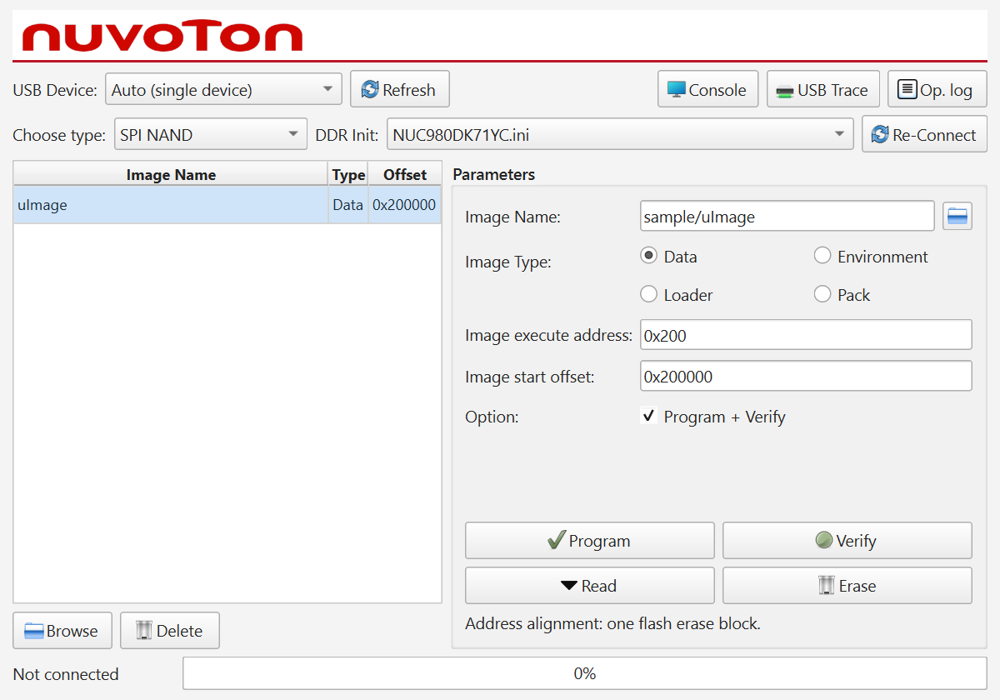
</p>

| Control | Operation |
| --- | --- |
| Verify | Read and compare a Data image without programming |
| Read | Save a byte range or the whole device to a file |
| Erase | Erase all good blocks or a specified aligned range |
| Format | Replace SD/eMMC partition settings; sizes are MiB and the last partition uses remaining space |

Use **Program + Verify** for Loader, Environment and Pack images.
SPI NOR whole-device reads require its capacity in bytes.

Read range:

<p align="center">
	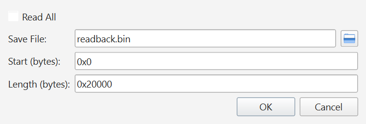
</p>

**Erase and Format destroy data. Back up first.** Erase is unavailable for SD/eMMC.
If an operation times out, check or reset the board before reconnecting.
Close the application only after the operation finishes; settings are saved on exit.

Erase All:

<p align="center">
	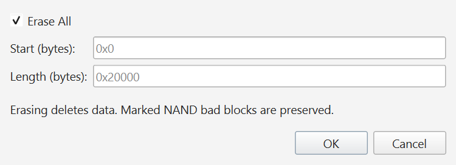
</p>

SD/eMMC Format:

<p align="center">
	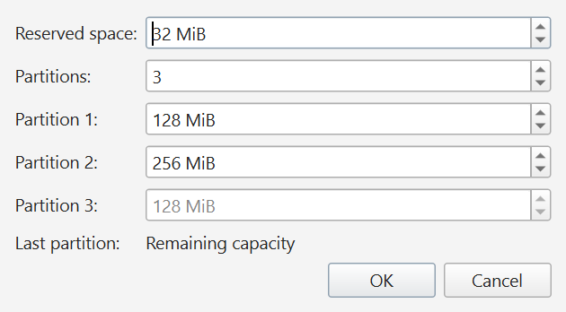
</p>

## SDRAM

Select **SDRAM**, choose an image and its load address, then choose **Download only** or **Download and run**.
Enable **DTB file** to supply a DTB and address; enable **Bootargs** to enter kernel parameters.
For raw Linux kernel execution, use `zImage`, not `uImage`, and matching DTB/rootfs files.
RAM downloading does not program flash, but software started on the board may write it.

<p align="center">
	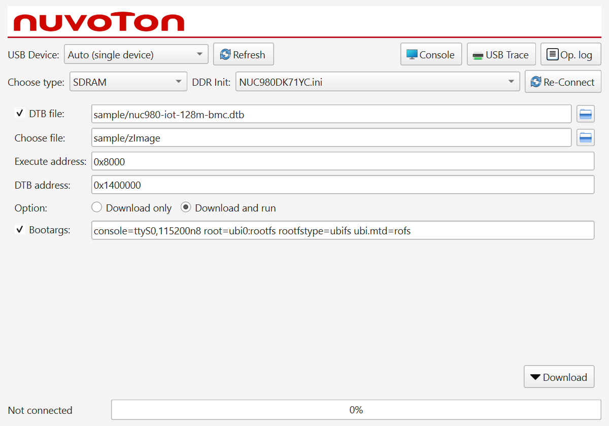
</p>

## Create And Program A Pack

1. Select **Pack** and open a [sample configuration](../sample/README.md) or your JSON file.
2. Use **Add**, **Modify**, and **Delete** to edit the image list. **Save JSON** saves the configuration.
3. Set the output path and click **Output** to generate the pack. No board connection is needed.
4. Select the target flash type, choose the generated file as **Pack**, then click **Program**.

<p align="center">
	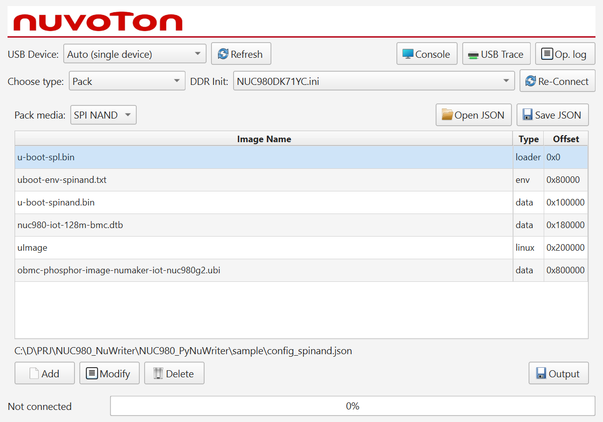
</p>

Relative image paths are resolved from the JSON directory. Confirm all offsets, DDR and flash settings before programming.
For the samples, keep the source ZIP's `sample` and `sys_cfg` directories together.
Single-board Pack programming does not automatically erase the whole device.
Pack verification excludes loader headers/DDR data, SD partition setup, OOB and unused areas.

<p align="center">
	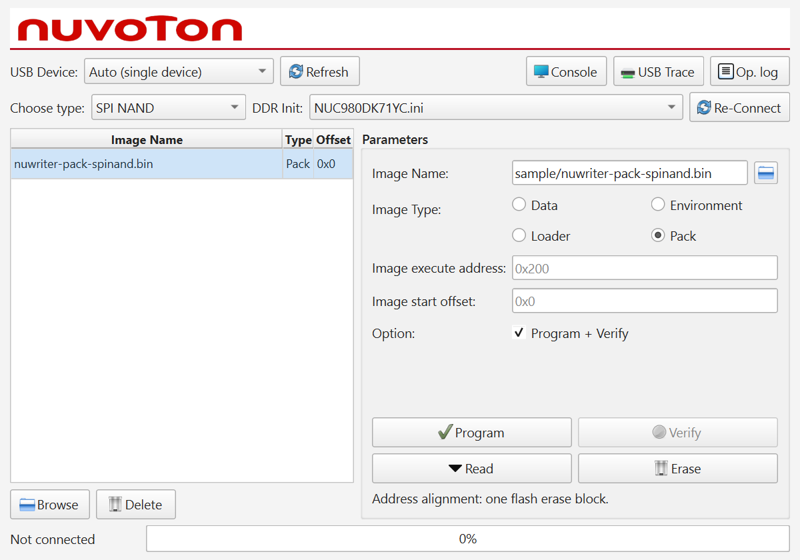
</p>

## Mass Production

1. Put every board in USB Boot mode and connect their USB Device ports.
2. Select **Mass Production**, the DDR setting and target media. Click **Re-Connect**.
3. Select a pack and start programming. Review each device's **Erase**, **Burn**, **Verify**, and final result.

**NAND/SPI NAND Mass Production erases all good blocks before programming.** SPI NOR and SD/eMMC skip the separate whole-device erase.
Boards run sequentially. Failed boards are not retried; later boards continue.

Example results (illustrative data):

<p align="center">
	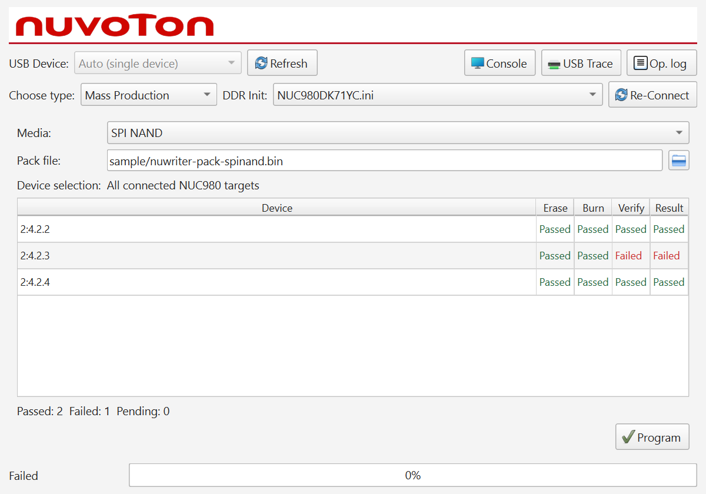
</p>

## Console And Logs

### Console

Select the debug UART port and baud rate, then click **Open**. Default: 115200, 8N1. Click **Close** before changing the port or baud rate. Hiding the console keeps the port open; closing its window releases it.

<p align="center">
	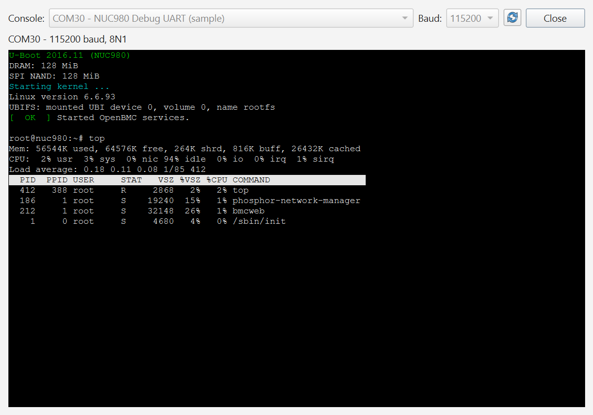
</p>

### USB Trace

Show the window to record USB transfers; hide it to stop recording. `<H->D>` means PC to board; `<D->H>` means board to PC. Data may contain image contents; review before sharing.

<p align="center">
	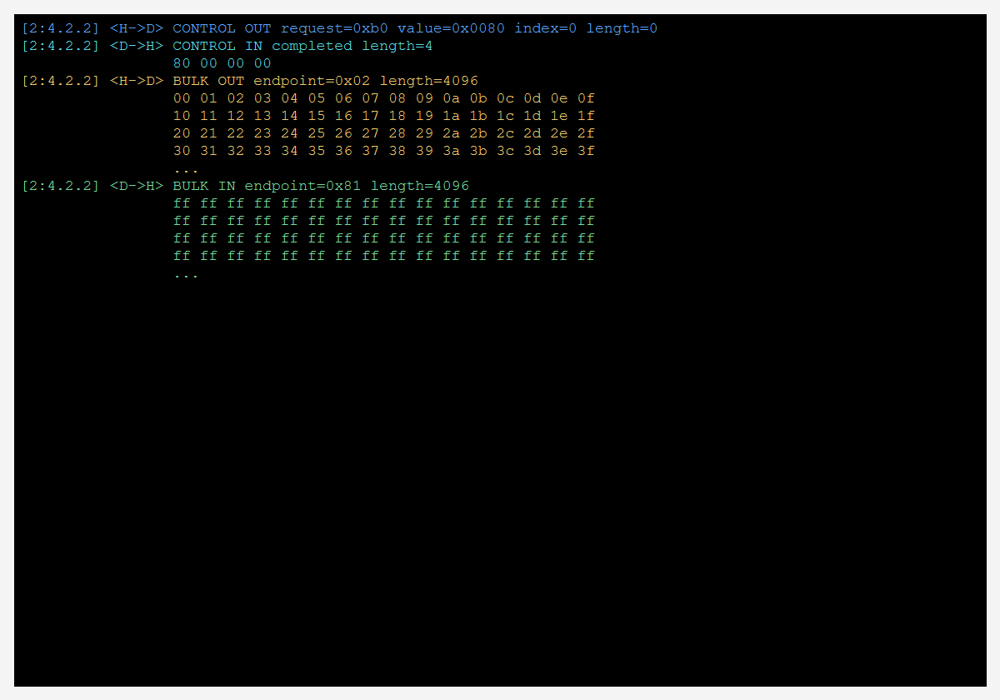
</p>

### Operation Log

Click **Op. log** to show commands, progress and errors. Click the same button to hide it. Text can be selected and copied.

<p align="center">
	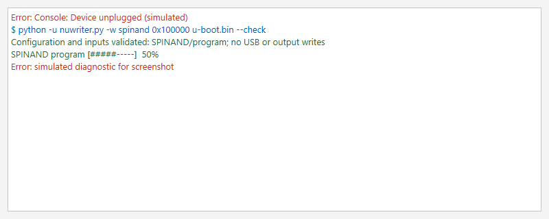
</p>